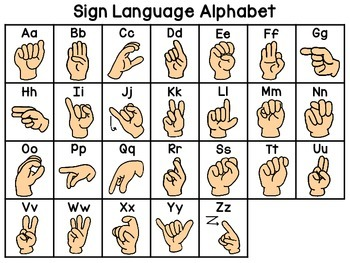

🤟 Bi-Directional Sign Language Translator with Voice Output

A Python-based assistive communication system that enables bidirectional communication between sign language and voice/text using computer vision and machine learning.

🚀 Features
🤟 Real-time hand gesture/sign recognition
🎙️ Voice-to-sign communication
🔊 Voice output for recognized signs
📷 Camera-based hand detection
🧠 Machine learning-based sign classification
🌐 Flask-based web interface
📊 Dataset and trained model integration
💻 User-friendly web interface
🛠️ Technologies Used
Python
Flask
OpenCV
MediaPipe
TensorFlow / Keras
Machine Learning
HTML
CSS
JavaScript
🔄 How It Works
Sign → Text / Voice
Camera
   ↓
Hand Detection
   ↓
Feature Extraction
   ↓
ML Model
   ↓
Sign Recognition
   ↓
Text Output
   ↓
Voice Output

Voice → Sign
Voice Input
   ↓
Speech Processing
   ↓
Text
   ↓
Sign Representation
   ↓
Web Interface

📁 Project Structure
Bi_Directional__SignLanguage_Translator_voice_output/
│
├── app.py
├── main.py
├── HandModel.py
├── fullsentance code.py
├── sample.py
├── rename.py
│
├── app_files/
├── dataset/
├── HandFinal/
├── model/
├── static/
├── templates/
├── Old/
│
├── keypoint_classifier_new.h5
├── sign.png
├── VOICE_TO_SIGN_SETUP.md
├── .gitignore
└── README.md

⚙️ Installation
1. Clone the repository
git clone https://github.com/jaganrobotics/Bi_Directional__SignLanguage_Translator_voice_output.git

2. Open the project
cd Bi_Directional__SignLanguage_Translator_voice_output

3. Create a virtual environment
python -m venv venv

4. Activate the virtual environment

Windows:

venv\Scripts\activate

5. Install required packages

Install the dependencies required by the project.

A requirements.txt file will be added to make installation easier.

▶️ Run the Project

Start the Flask application:

python app.py

Then open the local URL displayed in the terminal, usually:

http://127.0.0.1:5000/

📸 Screenshots

Screenshots of the application will be added here.

Example:

🎯 Project Objective

The goal of this project is to develop an assistive communication system that helps bridge the communication gap between sign language users and people who do not understand sign language.

The system provides two-way communication:

Sign Language → Text / Voice

Voice → Sign Language

🔮 Future Improvements
Improve sign recognition accuracy
Support a larger vocabulary
Sentence-level sign language translation
Improve real-time performance
Add mobile application support
Deploy the application online
Support additional sign languages
👨‍💻 Author

Jagan

GitHub: https://github.com/jaganrobotics

📄 License

This project is developed for educational and project-development purposes.

Third-party libraries, datasets, models, and source code are subject to their respective licenses.